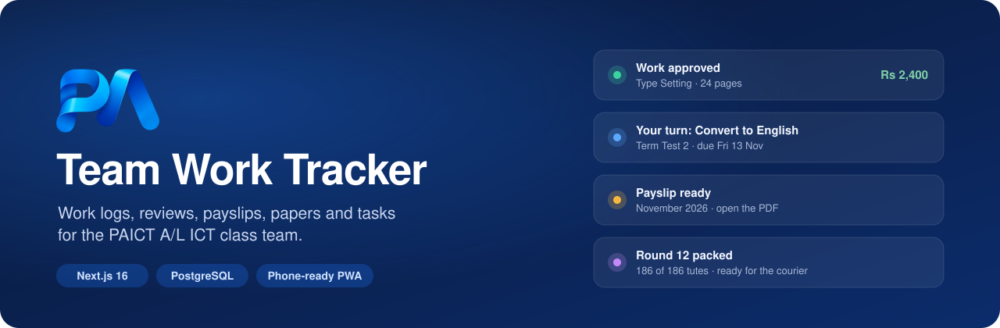
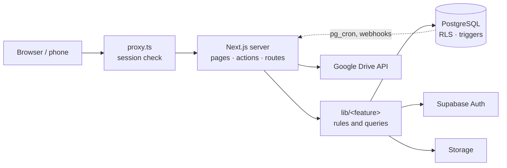

<p align="center">
  
</p>

<p align="center">
  <a href="https://github.com/hemalkph/Members-Managemnt-PAICT/releases/latest"></a>
  
  
  
  
  
</p>

<p align="center">
  <a href="#features">Features</a> ·
  <a href="#how-its-built">How it's built</a> ·
  <a href="#security">Security</a> ·
  <a href="#run-it-yourself">Run it yourself</a> ·
  <a href="#releases">Releases</a> ·
  <a href="#faq">FAQ</a>
</p>

---

**Team Work Tracker** is the internal system of the PAICT A/L ICT class team. Members log the work they do (typesetting, paper creating, marking, design, video editing and more), admins review it, and the system turns approved work and fixed salaries into monthly payslips. It also runs the paper production line, tasks, the paper library and tute dispatch to students.

It works on phones and computers, can be installed like an app, and sends phone alerts when something needs you. Sign-up is closed: admins add members.

> [!TIP]
> **New: video work from Google Drive.** Video editors tick the videos they edited in the team's *Social Media Videos* folder, and the quantity fills in by itself. No uploads, and a video can't be claimed twice. [See below](#for-members).

## Features

### For members

| | |
|---|---|
| 📝 **Log work** | Pick a role and type of work, add a title, quantity, links and files. Rates fill in the amount. |
| 📄 **PDF page count** | Typesetters attach a PDF and the page count becomes the quantity. |
| 🎬 **Videos from Google Drive** | Video editors tick their edited videos from this month's *Edited* or *External edits* folder. |
| ✅ **My work** | Every entry with its status (pending, approved, rejected) and the reviewer's comment. Edit while pending. |
| 📋 **My tasks** | Tasks from admins, with due dates, files and a WhatsApp button. Log work straight from a task. |
| 💰 **Payslips** | A PDF payslip for every closed month: salary lines, work lines (quantity × rate) and the paid date. |
| ⏰ **Deadlines** | A countdown to the monthly work deadline, with reminders before it. |
| 🔔 **Alerts** | A bell in the app and phone notifications for reviews, payslips, payments, tasks and "your turn". |
| 🎂 **Birthdays** | Read from the NIC. A small celebration on the day. |
| ⌨️ **Quick search** | <kbd>Ctrl</kbd> / <kbd>⌘</kbd> <kbd>K</kbd> jumps to any page or switches the theme. |

### For admins

| | |
|---|---|
| 🔍 **Work review** | Filter by month, section, role, member and status. Approve or reject with a comment, or approve many at once. |
| 👥 **Members** | Add members by invite or temporary password, assign roles, deactivate. Only main admins reset passwords; members can't reset their own. |
| 🏷️ **Rates and salaries** | Prices per page, design or paper, fixed monthly salaries, and a live budget preview in a phone mock-up. |
| 📊 **Analytics** | Monthly spending, spending by section and role, budget used and payouts per member. |
| 💸 **Payments** | Close a month to lock its work and create payslips, download the payroll CSV, mark people as paid. |
| 📑 **Reports** | Approved work per member and role, and per exam, with CSV export. |
| 📜 **Activity log** | Every approval, rate change, payment and access change, with who did it and when. Written by the database, so it can't be edited. |
| 🔐 **Page access** | Give a member one admin page (view only or edit), protected by two-step login. |
| 📣 **Notice board** | Pinned notices with an end date, shown on every member's dashboard. |

### Papers, library and tasks

| | |
|---|---|
| 🧾 **Paper production** | Create → Type set → Convert to English → Mark, with an owner and due date per stage. The next owner gets "Your turn". |
| 🗂️ **Versioned files** | Every stage keeps its files as v1, v2… in private storage. |
| 📚 **Paper library** | Finished papers and marking schemes by language, with notifications for printing and the LMS. |
| 📌 **Tasks** | Assign work with a quantity, due date and priority; reminders the day before, on the day and when overdue. |
| 🏆 **Performance** | On-time rate and speed per member and stage. |

### Tute dispatch

| | |
|---|---|
| 📦 **Rounds** | Plan which tutes go to which students, import student lists from Excel, copy an earlier round. |
| 📷 **Packing station** | Scan tutes with the phone camera or a barcode scanner, step-by-step guidance, team view and counts. Sinhala and English. |
| 🚚 **Courier** | Read waybill PDFs, track parcels, record hand-overs to the courier. |
| 💵 **Cash on delivery** | Settlements, money reports and round closing. |
| 🧹 **Privacy** | Student details and courier files are deleted after the keep time set by admins. |

## How it's built

| Part | Technology |
| --- | --- |
| Pages | Next.js 16 (App Router), React 19, Tailwind CSS 4, shadcn/ui |
| Forms | react-hook-form and Zod (the same rules run in the browser and on the server) |
| Server | Server Components, Server Actions and route handlers on Vercel (Singapore) |
| Database | PostgreSQL on Supabase: Row Level Security, SQL functions, triggers, pg_cron |
| Login | Supabase Auth with authenticator-app two-step login (required for every admin) |
| Files | Private Supabase Storage; videos stay in Google Drive |
| Alerts | Web Push through a service worker |
| Tests | Vitest: unit tests and database security / concurrency tests |



The full write-up, with layers, request flows, the data model and where new code goes, is in **[docs/ARCHITECTURE.md](docs/ARCHITECTURE.md)**.

```
app/            pages and routes: (auth) login, (app) member and admin pages, api, files
components/     React components: ui/ base components, one folder per feature
lib/            actions/ (every write) and one folder per feature: auth, core, members,
                organisation, work, payments, papers, tasks, notifications, dispatch
supabase/       migrations/ (tables, security rules, functions, triggers) and seed.sql
tests/          unit/ pure logic · db/ security rules and concurrency
proxy.ts        runs before every page: refreshes the session, guards private pages
```

## Security

- **Row Level Security on every table.** Members read and change only their own data; the anonymous role has no access at all.
- **The database enforces the rules.** Triggers stop members from making themselves admin, editing reviewed work or changing a closed month, even through the API.
- **Two-step login for every admin.** Admin powers and admin pages need the authenticator code, checked inside the database, so a stolen password alone opens nothing. Anyone who turned two-step on also needs the code for their own bank details, salary and payslips.
- **Checked twice.** Every Server Action validates its input with Zod and checks the session again with Supabase Auth.
- **Private files.** Files open through `/files/<id>`, which checks access and redirects to a link that expires in 60 seconds.
- **Bank details** live in their own table; pages only load the last 4 digits. Admins can read them; only the member or a main admin can change them.
- **Phone alerts follow the login:** they stop when you log out, and go only to phones whose login is still active.
- **Audit trail.** The activity log and payslips are written only by database functions; nobody can edit or delete them.
- **Secrets stay on the server.** The service-role, push and Google keys are never sent to the browser.

## Run it yourself

<details>
<summary><b>1. Create the Supabase project</b></summary>

1. Go to <https://supabase.com/dashboard> → **New project**. Pick a region close to Sri Lanka (Singapore or Mumbai) and save the database password.
2. Open **Project Settings → API** and copy the **Project URL**, the **anon / publishable** key and the **service_role / secret** key (keep this one private).

</details>

<details>
<summary><b>2. Run the migrations and seed</b></summary>

The schema is in [`supabase/migrations`](supabase/migrations) (one file per change, numbered in order) and the starter data in [`supabase/seed.sql`](supabase/seed.sql).

**Option A: SQL editor.** Open **SQL Editor → New query**, paste each migration file **in filename order** and press **Run**. Then run `seed.sql`. Every migration is safe to run twice.

**Option B: Supabase CLI**

```bash
npx supabase login
npx supabase link --project-ref <your-project-ref>
npx supabase db push            # runs the migrations
# then run supabase/seed.sql in the SQL editor (db push does not run seeds)
```

For a local Supabase stack (Docker), `npx supabase start` and then `npx supabase db reset` run the migrations **and** the seed.

> **Sample members:** the seed creates `nimal.perera@example.com`, `kavindi.silva@example.com`, `tharindu.fernando@example.com` and `sachini.jaya@example.com`, all with password `Password123!`. Delete them in **Authentication → Users** before real use.

</details>

<details>
<summary><b>3. Configure Supabase Auth</b></summary>

In **Authentication → URL Configuration**:

- **Site URL**: `http://localhost:3000` (later your real domain)
- **Redirect URLs**: `http://localhost:3000/**` and `https://<your-domain>/**`

In **Authentication → Sign In / Providers → Email**, turn **off** "Allow new users to sign up". Admins add members from the app.

**Required:** in **Authentication → Emails**, change the links so invite and recovery emails also work on another device:

- Invite user: `{{ .SiteURL }}/auth/confirm?token_hash={{ .TokenHash }}&type=invite`
- Reset password: `{{ .SiteURL }}/auth/confirm?token_hash={{ .TokenHash }}&type=recovery`

**Passwords:** members can't reset their own password: the login page has no "Forgot password", and a recovery link only works for main admins. A main admin resets anyone else's password from **Members → Reset password**. If a main admin forgets theirs, the other main admin resets it, or send them a recovery email from the Supabase dashboard (**Authentication → Users → Send password recovery**).

> The free Supabase email service only sends a few emails per hour. For a whole team, set up custom SMTP or add members with **Set a password** instead of an invite.

</details>

<details>
<summary><b>4. Set the environment variables</b></summary>

```bash
cp .env.example .env.local
```

| Variable | Needed for |
| --- | --- |
| `NEXT_PUBLIC_SUPABASE_URL` | Everything. The Supabase project URL |
| `NEXT_PUBLIC_SUPABASE_ANON_KEY` | Everything. The anon / publishable key (RLS protects the data) |
| `NEXT_PUBLIC_SITE_URL` | Links in emails, e.g. `http://localhost:3000` |
| `SUPABASE_SERVICE_ROLE_KEY` | **Server only.** Inviting, creating and deactivating members |
| `NEXT_PUBLIC_VAPID_PUBLIC_KEY`, `VAPID_PRIVATE_KEY`, `VAPID_SUBJECT` | Phone alerts (create the keys with `npx web-push generate-vapid-keys`) |
| `APP_HOOK_SECRET` | **Server only.** At least 32 characters; the database sends it when it calls `/api/hooks/*` |
| `GOOGLE_SERVICE_ACCOUNT_KEY`, `GOOGLE_DRIVE_VIDEOS_FOLDER_ID` | **Server only.** The video picker (a view-only Google service account) |

Keys without a `NEXT_PUBLIC_` prefix never reach the browser. Never commit `.env.local`. For database webhooks, save the app's address and the same hook secret in Supabase **Vault** as `app_hook_url` and `app_hook_secret`.

</details>

<details>
<summary><b>5. Run the app locally</b></summary>

Requires Node.js 20.9 or newer.

```bash
npm install
npm run dev          # http://localhost:3000
```

| Command | What it does |
| --- | --- |
| `npm run typecheck` | Route types and `tsc --noEmit` |
| `npm run lint` | ESLint |
| `npm test` | Unit tests |
| `npm run test:db` | Database security and concurrency tests |
| `npm run build` / `npm start` | Production build and run |

</details>

<details>
<summary><b>6. Create the first admin</b></summary>

1. In Supabase, **Authentication → Users → Add user → Create new user**, with **Auto Confirm User** ticked.
2. In the **SQL Editor**, run (with your email):

   ```sql
   update public.profiles set is_admin = true, is_main_admin = true where email = 'you@example.com';
   ```

   `is_main_admin` makes you an owner: only main admins see Analytics, Payments and Rates.
3. Log in. Admins are asked to turn on two-step login first (Google or Microsoft Authenticator).
4. Add the rest of the team from **Members → Add member**.

**An admin lost their phone:** a main admin presses **Reset** next to their name in **Two-step login**. If nobody can log in, run this in the SQL Editor, then set it up again:

```sql
delete from auth.mfa_factors where user_id = (select id from auth.users where email = 'you@example.com');
```

</details>

<details>
<summary><b>7. Deploy</b></summary>

1. Import the repository in Vercel. The server region is set to Singapore in `vercel.json`, next to the database.
2. Add the environment variables from step 4 (set `NEXT_PUBLIC_SITE_URL` to the real domain).
3. Add the domain to Supabase **Site URL** and **Redirect URLs**.

Every push to `main` deploys to production; every other branch gets a private preview link.

</details>

### App switches

A few choices are switches in [`lib/core/config.ts`](lib/core/config.ts):

| Switch | Default | Effect |
| --- | --- | --- |
| `SHOW_MEMBERS_THEIR_EARNINGS` | `true` | Members see prices and their estimated earnings |
| `MEMBERS_CAN_SEE_PAYSLIPS` | `true` | Members can open their own payslips |
| `PAYROLL_CSV_INCLUDES_FULL_ACCOUNT_NUMBER` | `true` | The payroll CSV has full account numbers (set `false` to mask them) |
| `ADMINS_CAN_REVEAL_ACCOUNT_NUMBER` | `false` | Admins can press **Show** on a member's account number |

### Monthly payments

1. Review all of the month's work in **Work review**. A month's period runs from the 11th to the 10th of the next month.
2. **Payments → Close month**: payslips are created and the month's work is locked.
3. Download the **Payroll CSV**, make the bank transfers, then **Mark as paid** with the date and reference.
4. Members open their payslips in **My payslips** and download the PDF.

## Releases

Versions follow `MAJOR.MINOR.PATCH`: a new **minor** version for new features, a **patch** for fixes. Each release on the [Releases page](https://github.com/hemalkph/Members-Managemnt-PAICT/releases) lists what changed, built from the merged pull requests.

To publish one after merging into `main`:

```bash
gh release create v1.1.0 --target main --title "1.1.0" --generate-notes
```

## FAQ

**Can anyone sign up?**
No. Sign-up is turned off; admins add members from the app.

**Why does the database check permissions when the app already does?**
So the rules hold even if someone calls the database API directly or the app has a bug. The app's checks give friendly messages; the database's checks are the real lock.

**What happens to work logged after the 10th?**
It counts for the next pay month. Each month's period runs from the 11th to the 10th, so salaries and work line up with the payment date.

**Where are the videos stored?**
In the team's Google Drive. The app only reads the folder with a view-only account and records which entry claimed which video.

**Does it work on phones?**
Yes. Open the site on a phone and choose **Add to Home Screen** to install it; turn on alerts in **Notifications**.

## Credits

- UI components from [shadcn/ui](https://ui.shadcn.com) (MIT) and animations from [React Bits](https://reactbits.dev) (MIT), adapted to TypeScript and Tailwind. All animations respect **Reduce motion**.
- PDFs with [pdf-lib](https://pdf-lib.js.org) and [unpdf](https://github.com/unjs/unpdf); charts with [Recharts](https://recharts.org).
