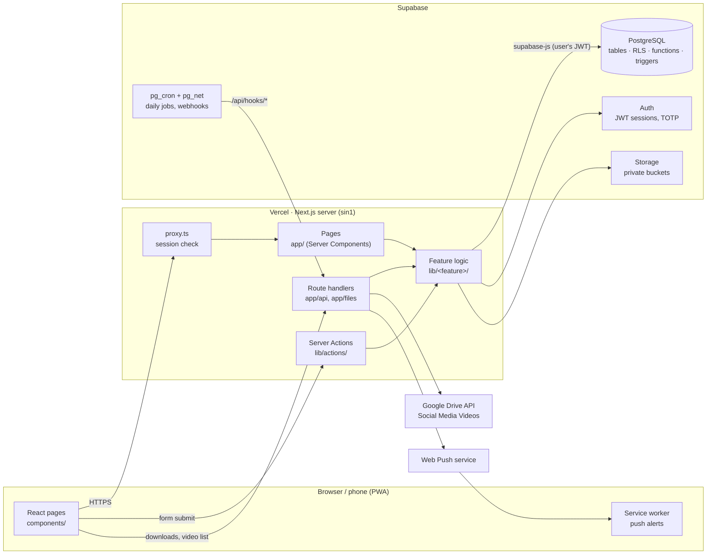
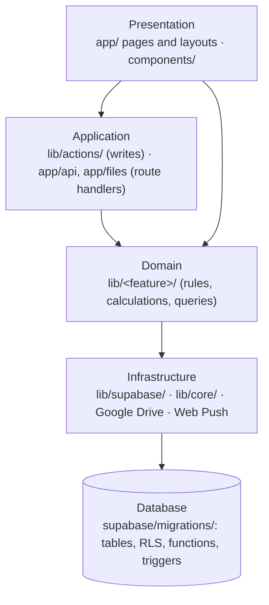
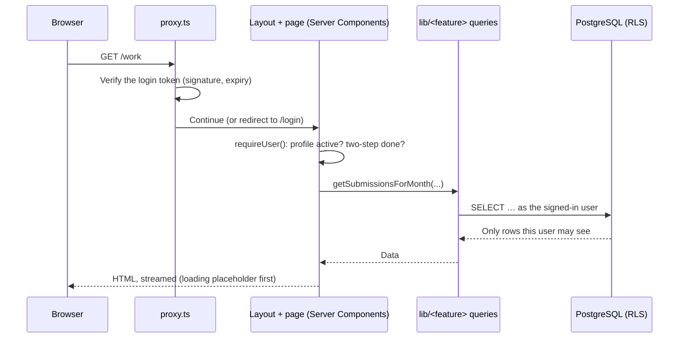
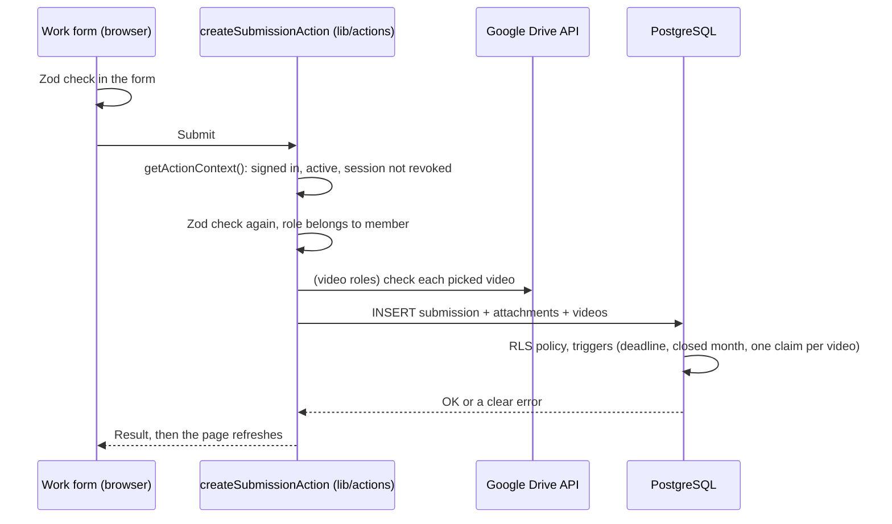

# Architecture

Team Work Tracker is the internal system of the PAICT A/L ICT class team. Members log the work they do (typesetting, paper creating, marking, design, video editing…), admins review it, and the system turns approved work and fixed salaries into monthly payslips. It also runs the paper production line, tasks, the paper library and tute dispatch to students.

This document explains how the code is organised and how a request travels through it.

---

## 1. Technology

| Layer | Technology | Why |
| --- | --- | --- |
| UI | React 19, Next.js 16 (App Router), Tailwind CSS 4, shadcn/ui (Radix) | Server-rendered pages, accessible components |
| Forms and validation | react-hook-form, Zod | The same Zod schema checks the form in the browser and again on the server |
| Server | Next.js Server Components, Server Actions and Route Handlers on Vercel (Singapore) | Pages and writes run on the server, close to the database |
| Database | PostgreSQL (Supabase) with Row Level Security, SQL functions, triggers, pg_cron | Business rules that must never be skipped live in the database |
| Auth | Supabase Auth (email + password, TOTP two-step login) | Signed JWT sessions, read by both the app and the database |
| Files | Supabase Storage (private buckets), Google Drive API (videos) | Short-lived signed links; large videos stay in the team's Drive |
| Notifications | Web Push (service worker), Postgres-created notifications | Phone alerts without a native app |
| Tests | Vitest (unit tests, database tests) | Pure logic, security rules and concurrency |

---

## 2. The big picture



Two ideas shape the whole system:

1. **Every request runs as the signed-in user.** The server talks to the database with the user's own login token, so PostgreSQL's Row Level Security decides what each person may read or change. The app checks permissions too, but the database has the final say.
2. **Rules that must never be skipped live in the database.** Price locking at approval, closed-month locks, the activity log, payslip creation and "one claim per video" are SQL functions and triggers. They work even if someone calls the database API directly.

---

## 3. Layers



| Layer | Folder | Responsibility | Rule |
| --- | --- | --- | --- |
| Presentation | `app/`, `components/` | Pages, layouts, forms, tables, charts | No database writes here; pages read through `lib/<feature>` queries |
| Application | `lib/actions/`, `app/api/`, `app/files/` | One function per user action (submit work, close month…). Validates input with Zod, checks who is signed in, calls the domain and database | Every action starts with `getActionContext()` and a Zod `safeParse` |
| Domain | `lib/<feature>/` | Business rules, calculations and read queries for one feature | Pure helpers are unit-tested; server-only files import `server-only` |
| Infrastructure | `lib/supabase/`, `lib/core/` | Database clients, generated types, env, formatting, dates, shared validation | No feature knowledge |
| Database | `supabase/migrations/` | Tables, Row Level Security, SQL functions, triggers, scheduled jobs | Each migration is safe to run twice |

---

## 4. Folder structure

```
.
├── app/                         Pages and routes (Next.js App Router)
│   ├── (auth)/                  Login, two-step code, forgot / reset password
│   ├── (app)/                   Signed-in area with the sidebar
│   │   ├── dashboard, work, tasks, papers, library, payslips, performance,
│   │   │   week, notifications, profile, bank, security       Member pages
│   │   └── admin/               Admin area: review, members, payments, analytics,
│   │                            rates, reports, papers, tasks, dispatch, activity…
│   ├── api/
│   │   ├── drive/               Video list and thumbnails from Google Drive
│   │   └── hooks/               Called by the database: push alerts, daily clean-up
│   ├── auth/                    Email link handler, sign-out
│   └── files/[id]               Private file → 60-second signed link
│
├── components/                  React components
│   ├── ui/                      Base components (shadcn/ui on Radix)
│   ├── reactbits/, animate-ui/  Animated components
│   ├── admin/, member/, payments/, papers/, tasks/, dispatch/, library/,
│   │   notifications/, analytics/, …                 One folder per feature
│   └── *.tsx                    App shell: sidebar, page header, theme, skeletons
│
├── lib/                         Logic, one folder per feature
│   ├── actions/                 Server Actions: every write the UI can make
│   ├── auth/                    Session, page access, admin menu
│   ├── core/                    Shared: config, env, validation (Zod), dates, formatting, storage
│   ├── supabase/                Database clients (browser, server, proxy, service) and types
│   ├── members/                 Member queries, roles, NIC, birthdays, profile completion
│   ├── organisation/            Sections, roles, rates, batches, exams, centres
│   ├── work/                    Work entries: reports, marking, deadlines, PDF pages, Drive videos
│   ├── payments/                Pay months, payslips (PDF), analytics
│   ├── papers/                  Paper production tracker, drafts, file clean-up
│   ├── tasks/                   Tasks, WhatsApp messages, performance
│   ├── notifications/           Notifications, notices, phone push, activity log
│   ├── dispatch/                Tute dispatch: rounds, packing, courier, money, reports
│   └── utils.ts                 Class-name helper used by the UI components
│
├── supabase/
│   ├── migrations/              37 ordered SQL migrations (46 tables)
│   └── seed.sql                 Starter sections, roles and rates
│
├── tests/
│   ├── unit/                    Pure logic (dates, money, parsing, access rules…)
│   └── db/                      Database tests: security rules and concurrency
│
├── public/                      Icons, logo, service worker, app manifest
├── proxy.ts                     Runs before every page: refreshes the session, guards private pages
├── next.config.ts, vercel.json  Build settings, security headers, server region
└── docs/ARCHITECTURE.md         This document
```

### Where new code goes

| You are adding… | Put it in |
| --- | --- |
| A page | `app/(app)/<name>/page.tsx` (members) or `app/(app)/admin/<name>/page.tsx` |
| Something the user saves | A Server Action in `lib/actions/<feature>.ts` |
| A read query or business rule | `lib/<feature>/` (`queries.ts` for reads) |
| A form or table | `components/<feature>/` |
| A form schema | `lib/core/validation.ts` |
| A table, rule or trigger | A new file in `supabase/migrations/` |
| A test | `tests/unit/<name>.test.ts` |

---

## 5. How a request works

### Opening a page



### Saving work



### Background jobs

| Job | Trigger | What it does |
| --- | --- | --- |
| Deadline and stage reminders | pg_cron, daily | Creates notifications before work deadlines and when a paper stage starts |
| Phone alerts | Database webhook → `/api/hooks/push` | Sends each new notification to the person's phones |
| Clean-up | pg_cron → `/api/hooks/cleanup` | Deletes old paper files, import files and student details past their keep time |

---

## 6. Security

Each request passes several independent checks. If one layer had a bug, the next would still stop it.

| Layer | Check |
| --- | --- |
| `proxy.ts` | No valid login token → redirected to `/login` |
| Pages (`lib/auth`) | `requireUser`, `requireAdmin`, `requirePage`, `requireMainAdmin`: active profile, page access, two-step login |
| Server Actions | `getActionContext()` also asks Supabase Auth, so a session ended elsewhere is refused at once; every input is checked with Zod |
| Database | Row Level Security on every table; triggers stop members from editing reviewed work, making themselves admin, or changing closed months |
| Two-step login | Main-admin powers (payments, rates, analytics, activity log) need an `aal2` session, checked in the database |
| Files | Private buckets; `/files/<id>` checks access, then redirects to a link that expires in 60 seconds |
| Audit | The activity log and payouts are written only by database functions; nobody can edit or delete them |
| Secrets | Service-role and Google keys live only in server environment variables, never in the browser |

---

## 7. Data model

46 tables, grouped by feature:

| Area | Main tables |
| --- | --- |
| People and access | `profiles`, `bank_details`, `member_roles`, `push_subscriptions` |
| Organisation | `sections`, `roles`, `rate_items`, `member_salaries`, `batches`, `exams`, `centres` |
| Work | `submissions`, `submission_attachments`, `submission_videos`, `month_deadlines`, `tasks`, `task_files` |
| Pay | `pay_months`, `payouts`, `app_settings` |
| Papers | `papers`, `paper_stages`, `paper_files`, `paper_notes` |
| Communication | `notifications`, `announcements`, `activity_log` |
| Tute dispatch | `students`, `dispatch_rounds`, `round_students`, `round_tutes`, `parcels`, `parcel_items`, `parcel_scans`, `parcel_events`, `handovers`, `cod_settlements`, … |

Key rules kept in the database:

- **Price lock:** when work is approved, the unit price and amount are copied onto the submission, so later rate changes don't rewrite history.
- **Pay months:** a month's work period runs from the 11th to the 10th. Closing a month locks its work and creates one payslip (payout) per member.
- **One claim per video:** a Drive video can be logged by only one work entry that wasn't rejected.

---

## 8. Testing and quality

| Check | Command | Covers |
| --- | --- | --- |
| Type check | `npm run typecheck` | Whole project, including route and database types |
| Lint | `npm run lint` | ESLint (Next.js rules) |
| Unit tests | `npm test` | Dates and pay periods, money, NIC parsing, access rules, dispatch logic, Drive folder names, PDF pages |
| Database tests | `npm run test:db` | Row Level Security per role, and concurrent packing / money / hand-over operations |
| Build | `npm run build` | Production build |

---

## 9. Deployment

| Part | Where |
| --- | --- |
| App | Vercel, server region Singapore (`sin1`); every push to `main` deploys, every branch gets a private preview link |
| Database, Auth, Storage | Supabase |
| Schema changes | A migration file in `supabase/migrations/`, run in the Supabase SQL editor |
| Secrets | Vercel environment variables (Supabase keys, push keys, Google Drive service account) |
