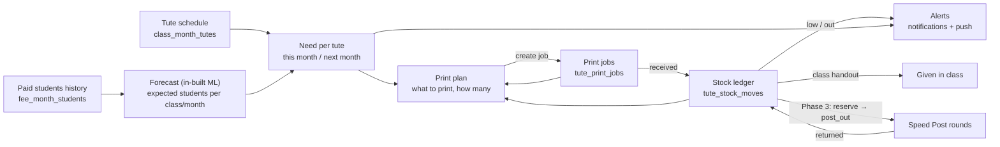
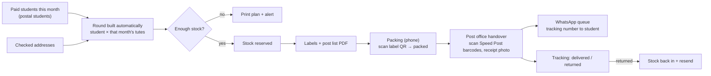

# Tute Inventory & Speed Post Dispatch — Plan

Status: **Phase 0 and Phase 1 built** on `feature/tute-inventory` (migration 063); Phase 2 onwards not started (2026-11-23).

Goal: one system that always knows **how many copies of each tute we have**, **how many we will need**, **what to print and when**, warns the team **before stock runs out**, and later **posts tutes to students by Speed Post** using the same stock numbers. All "smart" parts run inside our own database and app: **no AI bills, no outside AI service**.

---

## 1. What we already have (and will build on)

| Piece | Where | Used for |
| --- | --- | --- |
| Batches and classes | `batches`, `fee_classes` | Which classes exist |
| Tute catalog | `class_tutes` (migration 062) | The list of tutes per batch; can link to a Paper Library paper (`paper_id`) |
| Tute schedule | `class_month_tutes` (migration 062) | Which tutes each class gets in which month (past, current, future) |
| Paid students per month | `fee_month_students` (migration 061) | Who paid each class each month, with `institute`, `district`, `is_new_student` — the history the forecasts learn from |
| Paper Library + print alert | migrations 036, 038 | Tutes are kept per language; the Library already tells the Physical Coordinator "send it for printing" |
| Notifications + phone push | `notifications`, `/api/hooks/push` | Any row in `notifications` already reaches phones — no new code for alerts |
| Daily jobs | pg_cron (`'30 3 * * *'` = 9:00 Sri Lanka) | Same pattern for stock alerts and nightly forecasts |
| Activity log, page access | `write_activity()`, `has_page()` | Every stock change is logged; a new `tutes` page key controls who sees it |
| Open-app catch-up | `sendDueRemindersLater()` in `lib/work/deadlines.ts` | Same pattern runs the stock alert check when someone opens the app, as a backup to the daily job |
| Sidebar badge | `pendingReviews` badge in `components/app-sidebar.tsx` | Same pattern shows the low / out count next to "Tutes" |
| Halls, exams | `centres`, `exams.exam_date` | Halls, if stock is kept per hall (decision 2); exam dates for a seasonal forecast later |
| WhatsApp queue + templates | `components/fees/whatsapp-queue-dialog.tsx` | Later: send tracking numbers to students |
| PDF | `pdf-lib` (installed) | Later: address labels and post lists |
| Charts | `recharts` (installed) | Stock and forecast charts |

**Not there yet:** student postal addresses. No table holds them today (the concession student records have a GN division only), so Phase 3 starts by collecting them.

**Needs a fix first:** `class_tute_delete` deletes a catalog tute outright (migration 062, line 208). Once stock history exists it must refuse and say "archive it instead" (`is_active = false`), so history is never lost.

**Data we don't keep today:** each paid-list upload replaces that month's list (migration 061, line 291), and there are no payment dates. So nothing records how payments come in across a month. Phase 1 starts a small upload log so that data exists later (section 7).

**The old Tute dispatch is already gone.** Migration 045 dropped its tables, functions and page. We do **not** reuse anything from it. What's left is only wording:

- `components/fees/tutes-manager.tsx:289` and `:586-594` ("ready for future Tute Dispatch")
- `docs/FEE_REMINDERS_GUIDE.md:126`
- One manual step 045 could not do: empty and delete the old `dispatch` storage bucket in Supabase Dashboard → Storage (check it is gone).

Old migrations are left as they are (never edit an applied migration). New tables use **new names** (`tute_…`, `post_…`) so they never clash with the old dispatch names (`parcels`, `dispatch_rounds`, `students`…).

---

## 2. The core idea: stock is a ledger, not a number

We never store "stock = 120" and overwrite it. Every change is a **movement** row (+50 printed, −32 given to class, −18 posted, +1 returned, −3 damaged, +2 count fix). Stock on hand = the sum of movements.

Why: nothing is lost, every number can be explained ("why is it 47?" → list of moves), two people working at once can't overwrite each other, and the activity log stays honest. Same idea as the payouts table: written only by database functions, never edited. A mistake is fixed with a correcting move, not a delete.



---

## 3. Made to feel familiar for members and admins

People should be able to use it without training:

- **Looks like the rest of the app.** Built only from existing components (PageHeader, StatCard, StatusBadge, ReportTabs, MonthSelect, EmptyState, TableSkeleton) with the same tables, filters and dialogs as Fee reminders and Paper Library. Status shown with chips, no coloured left strips.
- **Plain words.** "On hand", "Printing", "Needed this month", "Print now". Never "SKU", "ledger" or "reorder point".
- **Every number explains itself.** Tap any number to see where it came from: the moves behind "on hand", or the sum behind "print 200".
- **Phone-first for the Physical Coordinator.** Big one-tap actions with the suggested number already filled in: *Received 200*, *Gave 45 to 2027 Theory*, *Counted 112*.
- **One "Today" card on the dashboard:** what to print, print jobs due, tutes low or out.
- **A count next to "Tutes" in the sidebar** for tutes low or out, like the Work review badge.
- **Stock shows where people already work.** The Fee reminders → Tutes tab shows a small stock chip next to each scheduled tute ("180 ready", "12 left", "100 printing"). Paper Library tute cards show the same chip with an **Order print** shortcut, and `/admin/tutes` shows a **"PDF ready"** badge on any linked tute (`paper_id`) that has finished Paper Library review with 0 stock and 0 print jobs.
- **Same alerts they already get.** The usual bell and phone push, one alert per change, never a daily nag.
- **Same access rules.** Members see the page only if given `tutes` access. Admins see everything. Catalog editing stays on Fee reminders → Tutes (one place, no duplicate screen).
- **A short guide** (`docs/TUTE_INVENTORY_GUIDE.md`, like the Fee reminders guide) and an entry in the welcome guide.

---

## 4. Phase 1 — Inventory core (build first)

### Database (one new migration)

| Object | What it holds |
| --- | --- |
| `class_tutes` + columns | `pages` (int), `reorder_level` (int, null = automatic), `print_batch` (round print quantities up to this, default 1). `medium` only if decision 1 picks a selector |
| `tute_printers` | Name, phone, notes, usual days to print. The real days are learned from that printer's jobs |
| `tute_print_jobs` | `tute_id`, `printer_id`, `qty`, `status` (planned → printing → received / cancelled), `cost`, `due_date`, `received_qty`, who/when (start and receive times give the real print time) |
| `tute_stock_moves` | `tute_id`, `qty` (+/−, never 0), `kind` (`opening_stock`, `print_in`, `class_issue`, `post_out`, `return_in`, `damaged`, `count_fix`), optional `class_id` + `month` (which month's need it covered), `centre_id` only if stock is kept per hall (decision 2), `ref_id` (print job / parcel), note, who/when. **Insert-only, through functions.** |
| `tute_alert_state` | Last alert level per tute (ok / low / out) so the team gets one alert per change, not one every day |
| `fee_month_upload_log` | One row per paid-list upload: class, month, student count, when. Written by a trigger on `fee_month_imports` (insert or update), so the upload code doesn't change. Nothing reads it yet; it's the history a mid-month forecast needs later |

Changes to existing objects:

- `class_tute_delete` refuses when the tute has stock moves or print jobs and says to archive it instead.
- The `class_tutes` read policy is widened from `has_page('fee_reminders')` to "fee_reminders **or** tutes".

Every stock function first locks that tute's row (`select … for update`), so two people receiving the same job or giving out copies at the same moment can't double-count or go below zero.

### Functions (these are the API — see section 8)

| Function | Does |
| --- | --- |
| `tute_stock_summary(batch, month)` | Per tute: on hand, reserved, in print, needed this month, needed next month, status (OK / Low / Out / Not scheduled) |
| `tute_printer_save(...)` | Add or edit a printer |
| `tute_print_job_create / _set_status / _receive(qty)` | Receiving writes a `print_in` move (partial deliveries allowed) |
| `tute_stock_issue(tute, qty, kind, class, month, note)` | Class handout, damaged, etc. Refuses to go below zero |
| `tute_stock_count(tute, counted, note)` | Stocktake: writes a `count_fix` move for the difference. A tute's very first count is saved as `opening_stock`, so loading today's shelf is just *Count* |
| `send_tute_stock_alerts()` | Daily pg_cron job (below) |

RLS: new page key `tutes` (`forMembers: true` so the Physical Coordinator can be given it).

### Alerts (automatic, no one has to remember)

Daily at 9:00, right after a print job is received or stock is issued, and as a backup whenever someone opens the app (same pattern as deadline reminders):

| Alert | When |
| --- | --- |
| **Low stock** | on hand + in print < need for the rest of this month + next month, or < reorder level |
| **Out of stock** | on hand = 0 and the tute is scheduled this month |
| **Month starting, not ready** | a month starts within lead time + 3 buffer days and a scheduled tute is short with no print job. Lead time = the usual days of that tute's last printer, else 7 days. Phase 1 uses each printer's usual days; Phase 2 switches to the learned real days |
| **Print job late** | job past `due_date` and not received |

No separate "PDF ready" alert: migration 038 already tells the Physical Coordinator to print when a paper (tutes included) reaches the library. The new part is only the **PDF ready** chip on screen.

Sent to members with the Physical Coordinator role and admins with the `tutes` page, through the existing `notifications` table, so phone push works with no new code.

### Screen — `/admin/tutes`

| Tab | Shows |
| --- | --- |
| **Stock** | KPI cards (tutes low / out / in print), table: tute, on hand, in print, need this month, need next month, status (plus a **PDF ready** chip when linked to a reviewed Paper Library tute with 0 stock / 0 printing). Row actions: *Received*, *Give to class*, *Count*, *Damaged* |
| **Print plan** | Phase 2 (below) |
| **Print jobs** | Open and past jobs by printer, mark printing / received, printer list with their real average print time |
| **History** | Every movement, who did it, filter by tute / kind / month |

Plus a "Tutes" entry in the sidebar (with the low / out count) and ⌘K menu, the dashboard "Today" card, and stock chips on Fee reminders and Paper Library.

---

## 5. Phase 2 — Print planner ("what should we print?")

For each month, for every tute scheduled in that month:

```
expected students (class, month) = paid count already uploaded for that month,
                                   or the forecast (section 7) — whichever is higher
need (tute, month)               = Σ expected students over every class that has the tute that month
                                   + safety stock (section 7) + usual loss rate (damaged / count fixes)
still to hand out                = need − copies already issued / posted for that tute and month
print now                        = round up to print_batch( still to hand out − on hand − in print ), never below 0
```

Until the forecast has enough history (under 4 months for a class), it uses a simple start rule: last month's paid × average pay-again rate + average new students, with a 5% buffer (at least 5 copies).

Every suggestion shows its reason in plain words — including the **Online (Speed Post) vs. Physical Hall** split (the class's forecast divided by last month's Online / Hall ratio from `fee_month_students.institute`, not two separate forecasts) so staff know which copies are needed earlier for posting — e.g. *"2027 Theory ~142 (90 Online + 52 Hall) + 2027 Revision ~88 expected, +14 safety, 60 on hand, 0 printing → print 190 (rounded to 200)"*, and has a **Create print job** button.

When the same tute is also scheduled next month (or across multiple classes), the row shows a multi-month bundling hint (e.g. *"Also scheduled next month: +95 copies"*) so staff can combine runs at the press instead of ordering two smaller batches.

It updates by itself: uploading a new paid list, scheduling a tute, receiving a print job or issuing stock all change the numbers on the next page load (need is computed live; only the forecasts are saved nightly).

---

## 6. Phase 3 — Speed Post dispatch (brand new, built later, not rushed)

Designed now so Phases 1–2 leave the right hooks, built only after the inventory has run for a couple of months.

### What Speed Post gives us

Sri Lanka Post tracks Speed Post Courier items **by reference number on slpost.gov.lk**. There is **no public booking or tracking API** for businesses. Third-party aggregators (e.g. TrackingMore) sell a Sri Lanka Post tracking API, but that's a paid service.

So the system does **everything except the post office counter**: it builds the parcel list, checks and reserves stock, prints labels and the post list, records tracking numbers, tells students, and handles returns.

### Flow



### Rules

- **Who gets a parcel:** students who paid for month M **and** are postal students (default: `institute` = Online) **and** have a checked address. Items = that class's tutes for month M.
- **Never twice:** a student can't be sent the same tute for the same month twice, across any number of rounds (unique on student + tute + month), unless the earlier parcel came back or was voided.
- **Brothers and sisters:** same address → one parcel with both sets (address checker, section 7), saving postage.
- **Top-up rounds:** students who pay mid-month are added to a weekly top-up round automatically.
- **Stock link:** building a round **reserves** its copies (Stock tab shows "reserved", and "available" = on hand − reserved). At handover the reservations are **committed**, which writes the `post_out` moves exactly once, even if the button is pressed twice or the network retries. Editing or cancelling a draft round **releases** them. Dispatch never edits stock itself; it only calls these stock functions.
- **Packing in groups:** parcels with the same set of tutes are grouped (*"42 parcels: Unit 07 + Past Paper Pack"*), so packers make identical bundles in a row. Each label is confirmed by scanning its QR code with the phone (the camera is already allowed in `next.config.ts`).
- **Tracking numbers:** scanned with the phone camera or a USB scanner, which types like a keyboard. Each number used once.
- **Returns:** marking a parcel *Returned* asks if the copies are usable (`return_in`) or damaged (`damaged`), and marks that address *needs checking* before the resend.

### Data (new migration, new names)

| Table | Holds |
| --- | --- |
| `student_addresses` | Private: student key, address lines, city, postal code, district, phone, source, checked by/at. Only the new `post` page can read it. Removed by the existing clean-up job after a keep time |
| `post_rounds` | Month, main / top-up, status (draft → packing → handed over → closed), post office receipt file |
| `post_parcels` | Round, class, student, **address copy at the time of posting**, tracking number (unique), status (planned → packed → handed over → delivered / returned / lost), postage cost, packed by/at |
| `post_parcel_items` | Parcel, tute, `student_key`, `month`, qty, `active` (boolean, default true). Unique index on `(student_key, tute_id, month) where active`, so Postgres itself blocks double-sends, even when two rounds are built at once. The function that marks a parcel *Returned* or *Void* sets `active = false` on its items in the same step, so the resend is allowed and nothing is deleted |
| `tute_stock_reservations` | Tute, qty, round, month, status (active → committed / released). Lives with the stock tables; only the reserve / commit / release functions write it |
| `post_tariffs` | Only if postage cost is tracked (decision 6): Speed Post weight bands and fees, editable by admins, used to estimate each round's postage from tute pages |

### Where addresses come from (decision needed)

1. LMS export, if it can include addresses (best: no extra work for students), or
2. A one-time form link sent through the existing WhatsApp queue (each student gets a private link; the form is a trust boundary: rate limit, validation, link expires), or
3. CSV import for the first batch.

### Tracking

- **Default, free:** status updated by hand, plus a button that opens the official tracker for that number. Returns are recorded when they come back.
- **Only if you later choose to pay:** a tracking aggregator posting to `/api/hooks/tracking` to mark delivered / returned automatically.

---

## 7. In-built AI & ML (zero cost)

Everything below runs **inside our own Postgres database** (plain SQL and the free `pg_trgm` extension Supabase already offers) or in our own TypeScript. No OpenAI / Gemini / AI Gateway calls, no per-use bills, and no student data leaves our database.

| Feature | How it works | Phase |
| --- | --- | --- |
| **Student forecast that picks its own method** | Every night, for each class, four simple methods are tested on that class's own past months: *same as last month*, *3-month average*, *exponential smoothing*, *trend smoothing (Holt)*. The one that would have been most accurate in past months is used. It gives a range ("120–150, most likely 138") worked out from its own past errors. Recalculated right after a paid list is uploaded | 2 |
| **Learns each class's habits** | From the paid history: % of students who pay again next month, new students per month (`is_new_student`), and, once a year of data exists, the same month last year (exam and holiday dips) | 2 |
| **Smart safety stock & print-by timing** | Safety stock = 1.65 × typical monthly forecast error (about a 95% chance of covering a month's need without over-printing). Separately, each printer's real lead time is learned from its past jobs (start → received) and, from Phase 2, replaces the printer's usual days in **when** the "Month starting, not ready" alert fires (`lead days + 3 buffer days` before the month starts). A typed `reorder_level` still overrides the automatic threshold | 2 |
| **Odd-number check** | Stocktake differences and handouts that don't fit the class size are compared with the tute's usual differences (median-based outlier check). Big ones get flagged, e.g. *"Unit 07 count is 40 below the record, about 3× more than usual. Check it."* The usual loss rate is added to the need | 2 |
| **Forecast report card** | The saved forecast vs the real paid count, per class per month. The Print plan shows how close the last 3 months were, so trust is earned, not assumed | 2 |
| **Address checker** | Fuzzy matching (`pg_trgm`) against a Sri Lanka post office / postal code list loaded once: suggests the right town and postal code for misspelt or mixed Sinhala/English addresses, flags unknown towns, and finds students sharing an address or phone (brothers and sisters → one parcel). A person confirms before it's used | 3 |
| **Return-risk flag** | Learns from returned parcels: return rate by district and post office, plus an address-completeness score. Risky parcels are flagged before posting so someone calls the student first | 3+ |
| **Smart search** | ⌘K understands short phrases like "unit 07 dec", "low stock", "print plan" with keyword and fuzzy matching. No language model needed | 1 |

The maths is written **once, in SQL**, because the 9:00 alert job and the page both need the same numbers. It's tested with the database tests (`PG_BIN=/opt/homebrew/bin npm run test:db`) on known inputs: no history, one month only, a sudden drop, zero stock, rounding.

**Left out on purpose** (each needs data we don't have yet, or isn't worth the upkeep):

| Idea | Why not now | When |
| --- | --- | --- |
| Mid-month pacing forecast ("96 paid by the 10th → about 160 by month end") and a "demand surge" alert built on it | Today's uploads replace the month's list and carry no payment dates, so there's nothing to learn from | After the Phase 1 upload log has ~6 months of history (Phase 4) |
| Auto-tuning the forecast's smoothing weights | With 3–5 months per class, tuning fits noise and gives a misleading accuracy score | Revisit at ~12 months |
| Reorder formula based on daily use | Tutes go out in monthly lumps and we have no class dates to measure a daily rate; monthly need + safety stock fits better | — |
| "Ask Tute AI" keyword bar or chat assistant | A real assistant needs a paid model; a Sinhala keyword list needs upkeep. ⌘K and the Stock page answer the same questions | — |

---

## 8. API endpoints (how everything links together)

Every action is a **Postgres function** with RLS, called from Server Actions in `lib/actions/tutes.ts`. Supabase already exposes each one over HTTP (`/rest/v1/rpc/<name>`) with the user's own login and the same access rules. So the inventory, the print planner and the future Speed Post dispatch all talk through **one API on the same stock numbers**. When the app moves to Express, each function becomes one route with the same name and inputs, with no logic rewrite.

| Endpoint (function) | Future Express route | Phase |
| --- | --- | --- |
| `tute_stock_summary(batch, month)` | `GET /api/tutes/stock` | 1 |
| `tute_stock_moves_list(filters)` | `GET /api/tutes/moves` | 1 |
| `tute_stock_issue(...)` | `POST /api/tutes/:id/issue` | 1 |
| `tute_stock_count(...)` (first count = opening stock) | `POST /api/tutes/:id/count` | 1 |
| `tute_printer_save(...)` | `POST /api/printers` | 1 |
| `tute_print_job_create / _set_status / _receive` | `POST /api/print-jobs`, `PATCH /api/print-jobs/:id` | 1 |
| `tute_print_plan(month)` | `GET /api/tutes/print-plan` | 2 |
| `tute_forecast(class, month)` | `GET /api/tutes/forecast` | 2 |
| `tute_stock_check(items)` | `POST /api/tutes/availability` | 3 |
| `tute_stock_reserve / _commit / _release(round)` (commit is safe to repeat) | used by post rounds | 3 |
| `post_round_build(month, kind)` (checks, then reserves) | `POST /api/post/rounds` | 3 |
| `post_parcel_pack / _set_tracking / _set_status` | `PATCH /api/post/parcels/:id` | 3 |
| `post_round_handover(round)` (commits the reservations → `post_out` moves) | `POST /api/post/rounds/:id/handover` | 3 |
| `/api/hooks/tracking` (route handler, secret-checked) | same | 3, only if paid tracking |

Alerts don't need an endpoint: they are notification rows, and the existing push hook delivers them.

We don't add a second copy of every action as a Next.js route: each extra route needs its own login and two-step check and its own tests, and nothing outside the app uses them yet. If fixed `/api/tutes` addresses are wanted anyway, start with read-only `GET` routes (stock, print plan) that call the same functions.

---

## 9. Build order

| Phase | Delivers | Depends on |
| --- | --- | --- |
| **0** | Remove "future Tute Dispatch" wording; confirm old `dispatch` bucket is deleted | — |
| **1** | Stock ledger with opening stock, printers, print jobs, stocktake, Stock page, alerts (daily + on app open), sidebar count, stock chips on Fee reminders and Paper Library, ⌘K search, dashboard card, upload log, safer tute delete | Tute catalog (done) |
| **2** | Print planner (with Online vs. Hall split & multi-month bundling hints), self-picking forecast, safety stock + print-by timing from real print times, odd-number check, report card | Phase 1 + monthly paid uploads |
| **3** | Addresses + checker, Speed Post rounds, stock reservations, grouped packing, labels, tracking numbers, WhatsApp tracking message, returns, postage tariffs (if needed) | Phase 1–2 running for ~2 months + address decision |
| **4** | Return-risk flag, mid-month pacing forecast (once the upload log has ~6 months), optional paid tracking, weekly summary notification | Phase 3 + a few months of posting |

Each phase is one branch from `origin/main`, one migration (safe to run twice, pasted in the Supabase SQL Editor), with:

- database tests: members without the page (or without two-step sign-in) can't read or write, stock moves can't be edited or deleted, can't issue below zero, two people receiving the same print job at once don't double-count, a tute with history can't be deleted, every upload adds one log row, committing a round twice posts stock out once, the same tute can't be posted twice to a student for a month but can be resent after a return, and the forecast and safety stock give the expected numbers on known inputs,
- typecheck, lint, build, and a check on a phone screen.

---

## 10. Decisions needed from you

1. **Sinhala and English medium:** two separate catalog tutes (e.g. "Unit 07 (Sinhala)" and "Unit 07 (English)"), or one tute with a Medium setting? Separate tutes need no new code, since each already has its own stock.
2. **Where stock is kept:** one central storeroom (handed out at halls on class day), or should we also track copies left at each hall?
3. **Who gets tutes by post?** Default: Online students only; institute students get theirs in class (issued from stock by class). Any exceptions, like absent hall students?
4. **Printing:** in-house printer, an outside press, or both? (Affects print batch rounding, printer profiles and cost per copy.)
5. **Addresses:** can the LMS export include addresses, or do we send a form link by WhatsApp?
6. **Postage:** do students pay postage, or does the class cover it? (Decides whether we need the tariff table and postage per student.)
7. **Tracking:** stay free (manual + official tracker link) — the plan's default — or ever pay for automatic tracking?

---

## 11. Risks

- **The forecast is only as good as the uploads.** If a month's paid list isn't uploaded, need falls back to the forecast alone, and the page says so.
- **Little history at first.** With few months per class, the forecast uses the simple start rule and wider ranges; it gets sharper each month, and the report card shows that.
- **Student identity drift.** `student_key` changes if a student switches Gmail; we match by phone the same way Fee reminders does (`lib/fees/compare.ts`) so nobody gets a second parcel.
- **Personal data.** Addresses are a new privacy surface: separate table, own page access, keep time, never leave our database.
- **No Speed Post API.** Booking stays a manual counter step; the system makes it fast (one list, scanned barcodes) but can't remove it.
- **Stack move.** Logic stays in Postgres functions and plain TypeScript and uses no Vercel-only or paid AI services, so it moves to Express + self-hosted Postgres unchanged.
